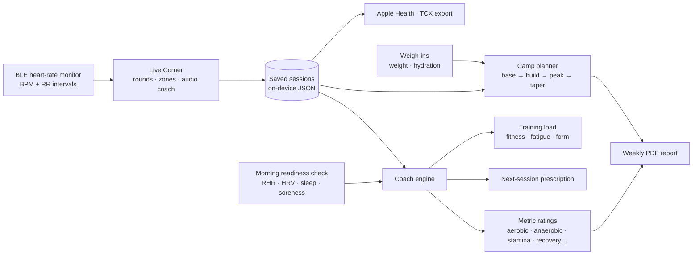

<p align="center">
  
</p>

<p align="center">
  <a href="https://github.com/drivepulator/FIGHT/actions/workflows/build.yml"></a>
  
  
  
  
  
</p>

<p align="center">
  <b>Turn every round into data.</b> FIGHT is an iPhone app for kickboxers, Muay Thai and MMA athletes. It streams your heart-rate monitor in real time, rates your performance on every tracked metric, and plans your next session, your fight camp and your weight cut around the numbers.
</p>

---

## Contents

- [Why it exists](#why-it-exists)
- [Features](#features)
- [How the coach thinks](#how-the-coach-thinks)
- [Supported sensors](#supported-sensors)
- [Install on your iPhone](#install-on-your-iphone)
- [Build from source](#build-from-source)
- [Project structure](#project-structure)
- [Privacy](#privacy)
- [Roadmap](#roadmap)
- [Disclaimer](#disclaimer)

## Why it exists

Generic fitness apps are built for runners. Fighters train in **rounds**, recover on a **stool**, cut **weight**, and peak for **one night**. FIGHT is built around that reality:

| Fighters ask… | FIGHT answers with… |
|---|---|
| *Am I recovered enough to spar today?* | A daily **readiness score** from training load, morning HRV, resting HR, sleep and soreness |
| *Is my gas tank getting better?* | **Fight Stamina** and **Recovery Speed** ratings built from round-by-round HR creep and 60-second stool recovery |
| *What should I do next?* | A specific **next-session prescription** (rounds, rest, target HR band), loaded into the round timer with one tap |
| *How hard should each week of camp be?* | A **periodized camp plan** counted back from fight night: base → build → peak → taper |
| *Am I cutting weight safely?* | A **weight-cut tracker** that flags dehydration from rapid loss, urine colour, elevated resting HR and suppressed HRV |
| *How do I show my coach?* | A **2-page weekly PDF report**, shared from your phone in seconds |

## Features

### 👊 Simple by design
- **Four tabs**: Today, Progress (with your fight camp inside it), History, You
- **Today answers the daily question**: train hard, go easy or rest, with the session ready to go, one insight and your goal (fight countdown, weight to go or fitness)
- **One-minute setup**: name and body, what you train (pick several, the first is your main sport) and the gear you own, fight format, your goal, then strap and AirPods
- **Only what you train**: workout types and bag combos follow your disciplines (no kicks for boxers, no grappling for strikers). Change it any time in You → My Training
- **Rounds found automatically** from your heart rate when you don't use the timer, and a short spoken debrief when you finish
- **Gloves-on control**: End Round and Start Next Round on the lock screen, or nod on the stool to start the next round
- **Starts the way you left it**: your last setup is remembered for each workout type, and the Start button says exactly what it will do
- **Three doors to start**: Fight (your sport → bag work, pads, shadowboxing, clinch, sparring, technique, or drilling and rolling for grapplers), Roadwork (easy run, fight-rounds run, sprints, hill sprints, recovery walk) and Conditioning (plyo, jump rope, circuit, mix, plans, fitness test). Then pick how long and press Start
- **Go again**: one card under the doors starts last time's workout, the coach's pick or a loaded plan in one tap
- **Coach answers first**: "Today: train hard / go easy / rest", then one button to load that session
- **Units your way**: tap or swipe the unit next to any height or weight to switch cm ⇄ ft/in and kg ⇄ lb
- **Try it with sample data**: You → Try FIGHT With Sample Data adds a sample fighter with three realistic sessions, a week of morning checks and an upcoming fight

### 🥊 Train: real-time round tracking
- **Live BPM and zones**: Garmin-style display with a 5-zone bar, current zone, elapsed time, and active vs. total calories
- **Round bell and corner timer**: work/rest intervals from 0:30 to 5:00, a gym-style bell and clapper, "Round 3 in 10 seconds" calls, and haptics on every bell
- **Crash-safe recording**: progress is autosaved every 30 seconds. If the app is closed mid-session, FIGHT offers to recover the workout on next launch
- **Coached bag work**: realistic kickboxing and Muay Thai combinations called out loud. The next combo is only called after you've heard the last one and had time to throw it.
  - **Your fighting style:** orthodox or southpaw, number calling (1 = jab, 2 = cross…), and four difficulty levels
  - **Combo variety:** a Dutch-style kick finish, defence and counters, and your own custom drills
  - **Pace:** five tempos from Technical to Burnout, with adaptive tempo that follows your heart-rate plan
  - **Round structure:** a "Final round" call, a 10-second clapper, a triple bell at round end, and a "Punch out!" flurry in each round's last 10 seconds
  - **Readable from the bag:** each strike lights up as it's spoken, in a natural voice (Enhanced voices when installed), with your music ducked underneath
- **Live audio coaching through AirPods**: zone changes, Zone 2 ceiling alerts, sustained-redline warnings, stool-recovery drop, periodic HR updates
- **Coach plan mode**: a target HR band on screen, with spoken alerts when you drift above it
- **Ghost sparring**: race your own past session (or an imported `.tcx`) and see the HR delta live
- **Automatic HRR-60 detection**: measures heart-rate recovery after every round and every big effort
- **Live aerobic-threshold indicator** (DFA α1 from beat-to-beat data)
- **Lock Screen and Dynamic Island** Live Activity with BPM, zone and round countdown
- **30-minute LTHR field test** that sets your lactate-threshold zones automatically
- **Corner coach** (on by default): pushes you when your heart rate or bag output drops below your own round-1 pace, tells you to breathe when you've been redlining for a minute or are still high early in the rest. At most one call every 45 seconds

### 🏃 GPS runs (roadwork and walks)
- **Big numbers while you run**: distance, current and average pace, moving time and heart rate. Distance and pace also on the Lock Screen and Dynamic Island
- **Spoken splits** every km (or mile): "Kilometre 3. 5 12. Heart rate 148." Auto-pause when you stop, "Resumed" when you go
- **Clean tracking**: poor fixes and GPS jumps are thrown out, the first settling seconds are ignored, elevation ignores altitude noise
- **Best device wins**: a Bluetooth GPS receiver (Location and Navigation profile) is used first; MFi receivers such as Garmin GLO and Bad Elf feed iOS location and are labelled "External GPS"; a foot pod (Running Speed and Cadence) keeps distance and pace going when the GPS signal drops under trees or between buildings
- **After the run**: map with the route coloured by pace, start and finish, splits with bars (fastest highlighted), elevation, Zone 2 share and heart-rate drift
- **Apple Health**: distance and the route are saved with the workout, so the run shows on a map in Fitness (and syncs on to Strava from Health)
- **Run stickers**: Route (your line over your own photo), Splits (km bars) and Roadwork (the fighter version with Zone 2 share)

### 🦘 Plyometrics and Mix
- **Four fighter plyo sessions**:
  | Session | What it builds |
  |---|---|
  | **Fight Power** | Leg drive for kicks and entries: box or squat jumps, broad jumps, skater bounds, split-jump switches |
  | **Punch Power** | Upper body and rotation: med-ball passes, rotational throws and slams (or explosive push-ups and band punches), all-out punching |
  | **Fast Feet** | Pogo, in-out and lateral hops, then a reaction game where the coach calls "Left! Up! Back!" at random |
  | **Plyo Rounds** | 20/10 bursts in your fight format, alternating jumping and ground rounds. The hard one |
- **Gear checklist before you start**: your gear is pre-ticked; untick what you didn't bring and the session swaps exercises (no box → squat jumps, no med ball → explosive push-ups)
- **Safe volume**: every session stays under a foot-contact cap for your level (100 / 120 / 140 landings), and rests end early once your heart rate has recovered
- **Jump height with AirPods**: each jump's height from time in the air, spoken best per set, and a quality stop when jumps drop more than 10%. The morning check has an optional 3-jump test: when it's 10% under your usual, the coach says your legs are tired and holds off on plyos
- **Coach's pick schedules plyos**: one or two a week, 48 h apart, not after hard sparring, once a week in the taper and none in fight week
- **Mix**: build one session from blocks (rope, bag, shadow, pads, any plyo, run, strength, cool-down) or start from Camp Classic, Power Day or Engine Day. Run it or save it as a plan

### 🧠 Coach: ratings, readiness and what to do next
- **Readiness (0–100)**: combines training form, HRV and resting HR versus your baseline, sleep, soreness, and time since your last hard session
- **Fight Fitness ratings**, each with a grade, a 4-week trend, the evidence behind it, and how to improve:
  | Metric | Built from |
  |---|---|
  | **Aerobic Base** | Weekly Zone 1–2 volume, cardiac drift on steady work, aerobic threshold vs. max HR, resting HR |
  | **Anaerobic Power** | Zone 4–5 volume, peak % of max HR, fastest 20-second HR surge, high-intensity rounds |
  | **Fight Stamina** | Early-to-late round HR creep, long-session drift, rounds per session |
  | **Recovery Speed** | 60-second stool recovery, late-round recovery retention, 7-day HRV trend |
  | **Consistency** | Sessions per week, active weeks |
  | **Load Balance** | Acute:chronic workload ratio, training monotony |
  | **Intensity Mix** | Easy / tempo / hard distribution vs. a polarized fighter model |
- **Next-session prescription**: recovery day, technical flow, or a targeted session for your weakest metric
- **Training-load chart**: fitness, fatigue and form (Banister impulse-response model)
- **Coach Review on every workout**: intent match, round consistency, recovery, pacing, peak output and coach-plan adherence, plus "next time" tips
- **Post-session effort rating (RPE)**: blends with heart rate into training load, because HR alone under-reads sparring, clinch and strength work
- **Auto-detects a new max HR** and prompts you to update your zones
- **2-minute morning readiness check**: resting HR plus HRV (RMSSD), with artifact correction. You can also import resting HR from Apple Health (e.g. Apple Watch)

### 📋 Training plans: from coach to fighter
- **Plan builder**: stack blocks into a session:
  - Bag rounds, restricted to the combos the coach chooses (e.g. *only 1-2s and low kicks*)
  - Intervals, timed drills (jump rope, shadowboxing, pads), steady cardio, strength sets, and rest
  - Each block can carry an HR target, a spoken coaching cue, and a technique video link
- **Targets in zones, not BPM**: one plan works for a whole team, because every fighter's phone converts "Zones 2–3" to *their* heart rate. Combos follow each fighter's stance automatically.
- **Guided runner**: "Up next" announcements between blocks, a big countdown, the coach's cue read aloud, a live on-target indicator, and Skip / +1 round / +1 min / Done controls
- **Share without accounts or servers**: send a `.fightplan` file (AirDrop, Messages, WhatsApp), a link, or a **QR code** your fighters scan in the gym. Resending an updated plan updates it on their phone.
- **Results back to the coach**: per-block completion, HR, time in target, rounds and strikes, plus RPE and notes, sent as a `.fightresult` file the coach can open in FIGHT
- **Templates**: *1-2 & Low Kick Sharpening*, *Fight-Pace Rounds*, *Muay Thai Clinch Day*, *Conditioning Circuit*, and *Technique + Roadwork*

### ⚡ Signature insights: what only your heart-rate data can tell you
- **Gas Tank**: projects whether you're ready for 3×2, 3×3 or 5×3 from how fast your heart rate climbs round after round and how your recovery fades, and names the round where you'd redline
- **Combo cost**: the bag coach logs every combination it calls, then measures the heart-rate price of each one. "Kicks cost you 2.1× the heart rate of punch combos"
- **FIGHT Benchmark**: a fixed 5 × 3 min test to repeat every 4 weeks. Same work every time, so "9 BPM lower, recovery +11" is real progress
- **What drives your performance**: finds your own patterns, such as sleep, HRV above baseline, back-to-back hard days and time of day, against your session scores and recovery
- **Head movement and defence**: AirPods count slips, rolls and pulls per round, find your *defensive redline* (the heart rate where your head movement collapses), warn "move your head" and "chin down" live, and track footwork bounce
- **Reaction drill**: the coach calls slips, rolls and pulls; AirPods time each reaction and check you slipped the right way
- **Bag hits**: the phone's microphone counts the strikes you land during bag work
- **Sparring log**: tag partners and score each round to see who pushes you hardest and whether you lose rounds to fatigue or technique
- **Sleep from Apple Health** feeds your morning check automatically
- **Breathing trainer**: paced in-4, out-6 breathing with a live coherence meter from your strap, optional breathing tones on the stool, and a check of whether it actually improves your recovery
- **Soreness map**: tap where it hurts in the morning check. The coach adjusts today's advice and spots patterns, like shin soreness after back-to-back kicking days
- **Records and badges**: personal records (best recovery, most hard rounds, longest Zone 2, most strikes called) with a spoken alert the moment you beat your best recovery
- **Share to your Instagram story**: five story cards (session with your heart-rate trace, benchmark progress, fighter card, new record, fight countdown), sent to Instagram as a movable sticker, with switches to hide your name and weight or show only improvements
- **Hands-free with Siri**: "Start bag coach in FIGHT", "End round in FIGHT", "FIGHT readiness check", with gloves on

### 📅 Fight Camp: plan, cut, report
- **Periodization planner**: set the fight date and camp length (4–16 weeks) to get weekly load targets, deload weeks, key sessions and intensity mix per phase, tracked against what you actually did
- **Weight-cut tracker**: daily weigh-ins (or imported from a smart scale via Apple Health), trend, required rate per week, projected fight-night weight, urine-colour hydration logging, and kg or lb
- **Rehydration plan**: a fight-week guide sized to how much you cut (fluids, electrolytes, carbohydrate)
- **Morning reminder**: a daily nudge to weigh in and take your readiness check
- **Dehydration and safety warnings**: rapid drops, dark urine, resting HR rising while weight falls, HRV suppression, unrealistic targets, and >5% left to cut in fight week
- **Body signals**: morning resting HR and HRV charted alongside your cut
- **This camp vs last camp**: weekly load lined up by weeks to fight, so you know if you're ahead or behind your last camp
- **Fight-night warm-up**: set your walkout time and get a warm-up that ends right on it, with a reminder for when to start
- **Weekly PDF report for your trainer**: ratings, sessions with review scores, camp progress, weight, health flags and the suggested next session

### 📈 History and analysis
- Full session detail with an interactive HR chart, automatic points of interest (peak redline, fastest recovery, output surges, Zone 5 entry), a round-decay chart and zone breakdown
- TRIMP load, cardiac drift, RMSSD, EPOC estimate and aerobic efficiency per session
- Overlay any two sessions to compare
- **TCX export** to Strava, Garmin Connect, TrainingPeaks and more
- **Full backup**: export all your data as a single zip file, to iCloud Drive or Files
- Lossless LZFSE archive compression for older sessions
- **Multiple fighter profiles** with individual zones (Karvonen, LTHR, % max or manual)

### ❤️ Apple Health
Finished sessions are saved as Health workouts, including the full heart-rate trace and active calories. Each discipline is mapped to its matching Health activity type: Kickboxing, Boxing, Martial Arts, Running and so on. FIGHT can also read body weight and resting heart rate from Health to fill weigh-ins and readiness automatically.

## How the coach thinks



Every rating is computed on your phone from your own data, using established sports-science models. These include Banister's fitness–fatigue model, TRIMP, the acute:chronic workload ratio, Foster's training monotony, RMSSD heart-rate variability, and DFA α1 aerobic-threshold detection. Scores compare your last 28 days against the 28 days before.

**→ Full methodology, formulas and references: [`docs/METHODOLOGY.md`](docs/METHODOLOGY.md)**

## Supported sensors

FIGHT works with **any Bluetooth heart rate monitor** that implements the standard Bluetooth Heart Rate Profile (service `0x180D`). That includes virtually every chest strap, armband and sports watch sold today.

| Sensor type | Examples | Live HR and zones | Round / recovery metrics | HRV readiness (at rest) | Threshold detection in exercise |
|---|---|:---:|:---:|:---:|:---:|
| **Chest strap** (ECG) | Polar H10 / H9, Garmin HRM-Pro / HRM-Dual, Wahoo TICKR, Suunto Smart Sensor | ✅ | ✅ | ✅ | ✅ |
| **Optical armband** | Polar Verity Sense, Scosche Rhythm, Wahoo TICKR Fit, generic armbands | ✅ | ✅ | ✅ if RR is broadcast | ⚠️ often too noisy |
| **Watch in broadcast mode** | Garmin, Polar, Coros, Suunto, Amazfit (HR broadcast setting) | ✅ | ✅ | ⚠️ varies | ❌ usually no RR |

**How connection works**
- **Detection:** sensors that advertise the heart-rate service are listed first. Watches and sensors that reveal it only after connecting appear under **Show all nearby devices**. FIGHT verifies the heart-rate service on connect, and tells you if a device doesn't provide one.
- **Sensor details:** manufacturer, model, battery and body location (chest, wrist and so on) are read automatically. The sensor's name is recorded with each Apple Health workout.
- **Reconnects:** if the signal drops mid-round, FIGHT reconnects automatically. When a sensor stops sending, the BPM is cleared after 5 seconds, so stale values are never recorded.

**Data quality.** Beat-to-beat (RR) features (HRV, DFA α1, threshold detection) check artifact rate and coverage first, and fall back to heart-rate-only analysis when the signal is too noisy. For the most accurate HRV and threshold detection, use a chest strap.

> **Apple Watch** doesn't broadcast standard Bluetooth heart rate on its own. To use one, you need a third-party heart-rate broadcast app on the watch.

## Install on your iPhone

No Mac needed. Every push to `main` is built in the cloud by GitHub Actions.

1. Open the [latest successful build](https://github.com/drivepulator/FIGHT/actions/workflows/build.yml) and download the **`FIGHT-IPA`** artifact.
2. Unzip it to get `FIGHT.ipa`.
3. Install it with [Sideloadly](https://sideloadly.io/) (Windows or macOS) using your Apple ID.
4. On the iPhone, trust the developer under **Settings › General › VPN & Device Management**, and enable **Developer Mode** if prompted.
5. Open the app, allow Bluetooth, put your sensor on, and connect it from the antenna icon.

> **Free Apple ID notes:** apps signed this way expire after 7 days, so re-install from Sideloadly to refresh (your data is kept). The app and its Live Activity widget together use 2 of your 3 free app slots. Whether Apple Health access is granted depends on your signing account. If it isn't, the rest of the app works normally.

## Build from source

**On a Mac (Xcode 15+):**

```bash
brew install xcodegen
git clone https://github.com/drivepulator/FIGHT.git
cd FIGHT
xcodegen generate
open FIGHT.xcodeproj
```

Set your signing team on both targets (`FIGHT` and `FIGHTWidget`), enable the HealthKit capability, and run on a device. Bluetooth isn't available in the simulator.

**In CI:** [`.github/workflows/build.yml`](.github/workflows/build.yml) generates the project, runs the unit tests for the analysis engines on an iOS simulator, builds an unsigned Release app, checks that the required `Info.plist` keys are present (Bluetooth, background modes, Live Activities, Health), embeds the HealthKit entitlement with an ad-hoc signature, and uploads the IPA.

> The `Info.plist` files in `Sources/` are the single source of truth. `project.yml` deliberately has no XcodeGen `info:` blocks, because those would overwrite the plists at generation time.

## Project structure

```
FIGHT/
├── project.yml                     # XcodeGen spec (app + Live Activity widget)
├── Config/
│   └── FIGHT.entitlements          # HealthKit
├── .github/workflows/build.yml     # Cloud build → IPA
├── Tests/FIGHTTests/               # Unit tests (HRV, coach, camp, combos, plans, insights)
├── docs/                           # Methodology, logo and banner
└── Sources/
    ├── PlanKit/                    # Shared plan format: strikes, plans, results, file/link/QR transfer
    ├── App/
    │   ├── FightApp.swift              # Tab shell and dependency injection
    │   ├── BLEHeartRateManager.swift   # Universal BLE Heart Rate Profile, RR, device info, auto-reconnect
    │   ├── WorkoutSession.swift        # Live workout engine: timing, rounds, autosave, saving
    │   ├── LiveWorkoutView.swift       # Train tab: quick start, live rounds
    │   ├── StoryShare.swift            # Instagram story cards and sharing
    │   ├── OnboardingView.swift        # First launch and morning check prompt
    │   ├── SampleData.swift            # Sample fighter for trying the app
    │   ├── BagCoach.swift              # Strikes, stance, difficulty, combo generator
    │   ├── BagSettingsView.swift       # Bag coach settings and custom-combo builder
    │   ├── AudioCoachEngine.swift      # Sequenced voice combos, bells, clapper, spoken coaching
    │   ├── CoachEngine.swift           # Ratings, load model, prescriptions, workout reviews
    │   ├── Insights.swift              # Gas tank, combo cost, benchmark, drivers, records, soreness, camp compare
    │   ├── InsightViews.swift          # Cards and sheets for the signature insights
    │   ├── HeadMotionTracker.swift     # AirPods head movement, chin, bounce, nods, jump height
    │   ├── Plyo.swift                  # Plyo sessions, Mix builder, plyo scheduling
    │   ├── RouteMath.swift             # GPS filter, auto-pause, splits, route simplification, sensor parsing
    │   ├── RunTracker.swift            # CoreLocation + Bluetooth GPS / foot pod run tracking
    │   ├── RunViews.swift              # Live run numbers, run summary map and splits
    │   ├── TrainingViews.swift         # Plyo and Mix sheets, disciplines and gear choices
    │   ├── Encouragement.swift         # Corner-coach push / breathe logic
    │   ├── FightIntents.swift          # Siri and Shortcuts
    │   ├── HRVMath.swift               # RR artifact correction, RMSSD, DFA α1, VT1 estimate
    │   ├── CoachView.swift             # Coach tab
    │   ├── ReadinessCheckView.swift    # 2-minute morning HRV / resting HR check
    │   ├── CampPlanner.swift           # Periodization and weight-cut analysis
    │   ├── CampView.swift              # Fight camp (inside Coach)
    │   ├── WeeklyReport.swift          # PDF report rendering
    │   ├── PlanViews.swift             # Plan library, builder, sharing, QR scan, import, results
    │   ├── PlanSupport.swift           # Per-fighter zone resolution, result packaging
    │   ├── HealthKitManager.swift      # Apple Health workout export
    │   ├── WorkoutStore.swift          # On-device persistence, archives, TCX import/export
    │   ├── Models.swift                # Profiles, zones, sessions, physiology formulas
    │   ├── Assets.xcassets             # App icon
    │   └── …                           # History, detail, comparison, settings views
    ├── Shared/                     # ActivityKit attributes (app ↔ widget)
    └── Widget/                     # Lock Screen and Dynamic Island Live Activity
```

## Privacy

- **No account, no server, no analytics.** All sessions, check-ins and weigh-ins are stored as JSON in the app's Documents folder, which you can browse in the iOS Files app.
- Data leaves the device only when you choose to: Apple Health export, TCX export, the PDF report, or a backup zip.

## Roadmap

- [ ] **FIGHT Coach**: a companion app for coaches (roster, plan assignment, compliance), built on the shared `PlanKit` format
- [ ] Sparring-partner tagging: HR cost and recovery by partner and role
- [ ] Fight log: compare fight-night heart rate with training (the "adrenaline tax")
- [ ] Apple Watch motion-based strike counting and output-per-heartbeat efficiency
- [ ] Sparring video synced to the HR trace
- [ ] Dual-sensor mode (e.g. armband + chest strap) for lab-grade HRV in hard rounds

Have an idea that would help fighters train smarter? [Open an issue](https://github.com/drivepulator/FIGHT/issues).

## Disclaimer

FIGHT provides training estimates derived from heart-rate data. It is **not a medical device** and does not provide medical advice. Weight cutting and dehydration carry serious health risks: work with a qualified coach, physician or sports dietitian, and follow your athletic commission's rules. Stop training and seek medical help if you feel unwell.

Product names mentioned under supported sensors are trademarks of their respective owners. FIGHT is an independent project and is not affiliated with any sensor manufacturer.
