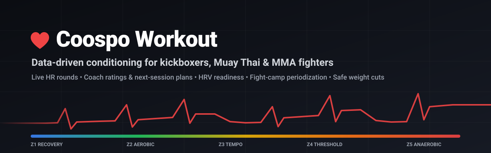
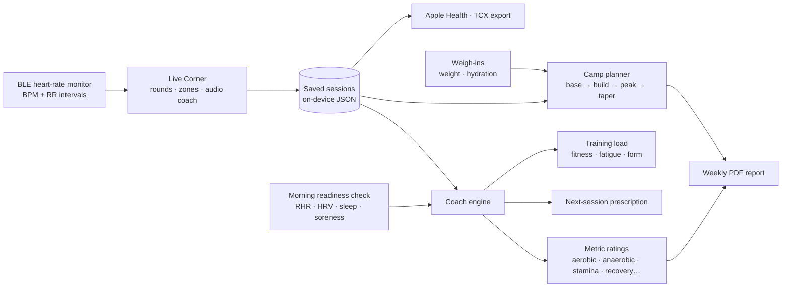

<p align="center">
  
</p>

<p align="center">
  <a href="https://github.com/drivepulator/FIGHT/actions/workflows/build.yml"></a>
  
  
  
  
  
</p>

<p align="center">
  <b>Turn every round into data.</b> FIGHT is an iPhone app for kickboxers, Muay Thai and MMA athletes. It streams your heart-rate monitor in real time, rates your performance on every tracked metric, and plans your next session, your fight camp and your weight cut around the numbers.
</p>

---

## Contents

- [Why it exists](#why-it-exists)
- [Features](#features)
- [How the coach thinks](#how-the-coach-thinks)
- [Supported sensors](#supported-sensors)
- [Install on your iPhone](#install-on-your-iphone)
- [Build from source](#build-from-source)
- [Project structure](#project-structure)
- [Privacy](#privacy)
- [Roadmap](#roadmap)
- [Disclaimer](#disclaimer)

## Why it exists

Generic fitness apps are built for runners. Fighters train in **rounds**, recover on a **stool**, cut **weight**, and peak for **one night**. FIGHT is built around that reality:

| Fighters ask… | FIGHT answers with… |
|---|---|
| *Am I recovered enough to spar today?* | A daily **readiness score** from training load, morning HRV, resting HR, sleep and soreness |
| *Is my gas tank getting better?* | **Fight Stamina** and **Recovery Speed** ratings built from round-by-round HR creep and 60-second stool recovery |
| *What should I do next?* | A specific **next-session prescription** (rounds, rest, target HR band), loaded into the round timer with one tap |
| *How hard should each week of camp be?* | A **periodized camp plan** counted back from fight night: base → build → peak → taper |
| *Am I cutting weight safely?* | A **weight-cut tracker** that flags dehydration from rapid loss, urine colour, elevated resting HR and suppressed HRV |
| *How do I show my coach?* | A **2-page weekly PDF report**, shared from your phone in seconds |

## Features

### 🥊 Live Corner: real-time round tracking
- **Live BPM and zones**: Garmin-style display with a 5-zone bar, current zone, elapsed time, and active vs. total calories
- **Round bell and corner timer**: work/rest intervals from 0:30 to 5:00, round warnings, and haptics on every bell
- **Guided bag work**: randomized voice combo callouts (punches, kicks, knees, elbows, defense) at a tempo you choose, mixed with your music
- **Live audio coaching through AirPods**: zone changes, Zone 2 ceiling alerts, sustained-redline warnings, stool-recovery drop, periodic HR updates
- **Coach plan mode**: a target HR band on screen, with spoken alerts when you drift above it
- **Ghost sparring**: race your own past session (or an imported `.tcx`) and see the HR delta live
- **Automatic HRR-60 detection**: measures heart-rate recovery after every round and every big effort
- **Live aerobic-threshold indicator** (DFA α1 from beat-to-beat data)
- **Lock Screen and Dynamic Island** Live Activity with BPM, zone and round countdown
- **30-minute LTHR field test** that sets your lactate-threshold zones automatically

### 🧠 Coach: ratings, readiness and what to do next
- **Readiness (0–100)**: combines training form, HRV and resting HR versus your baseline, sleep, soreness, and time since your last hard session
- **Fight Fitness ratings**, each with a grade, a 4-week trend, the evidence behind it, and how to improve:
  | Metric | Built from |
  |---|---|
  | **Aerobic Base** | Weekly Zone 1–2 volume, cardiac drift on steady work, aerobic threshold vs. max HR, resting HR |
  | **Anaerobic Power** | Zone 4–5 volume, peak % of max HR, fastest 20-second HR surge, high-intensity rounds |
  | **Fight Stamina** | Early-to-late round HR creep, long-session drift, rounds per session |
  | **Recovery Speed** | 60-second stool recovery, late-round recovery retention, 7-day HRV trend |
  | **Consistency** | Sessions per week, active weeks |
  | **Load Balance** | Acute:chronic workload ratio, training monotony |
  | **Intensity Mix** | Easy / tempo / hard distribution vs. a polarized fighter model |
- **Next-session prescription**: recovery day, technical flow, or a targeted session for your weakest metric
- **Training-load chart**: fitness, fatigue and form (Banister impulse-response model)
- **Coach Review on every workout**: intent match, round consistency, recovery, pacing and peak output, plus "next time" tips
- **2-minute morning readiness check**: resting HR plus HRV (RMSSD), with artifact correction

### 📅 Fight Camp: plan, cut, report
- **Periodization planner**: set the fight date and camp length (4–16 weeks) to get weekly load targets, deload weeks, key sessions and intensity mix per phase, tracked against what you actually did
- **Weight-cut tracker**: daily weigh-ins, trend, required kg/week, projected fight-night weight, and urine-colour hydration logging
- **Dehydration and safety warnings**: rapid drops, dark urine, resting HR rising while weight falls, HRV suppression, unrealistic targets, and >5% left to cut in fight week
- **Body signals**: morning resting HR and HRV charted alongside your cut
- **Weekly PDF report for your trainer**: ratings, sessions with review scores, camp progress, weight, health flags and the suggested next session

### 📈 History and analysis
- Full session detail with an interactive HR chart, automatic points of interest (peak redline, fastest recovery, output surges, Zone 5 entry), a round-decay chart and zone breakdown
- TRIMP load, cardiac drift, RMSSD, EPOC estimate and aerobic efficiency per session
- Overlay any two sessions to compare
- **TCX export** to Strava, Garmin Connect, TrainingPeaks and more
- Lossless LZFSE archive compression for older sessions
- **Multiple fighter profiles** with individual zones (Karvonen, LTHR, % max or manual)

### ❤️ Apple Health
Finished sessions are saved as Health workouts, including the full heart-rate trace and active calories. Each discipline is mapped to its matching Health activity type: Kickboxing, Boxing, Martial Arts, Running and so on.

## How the coach thinks



Every rating is computed on your phone from your own data, using established sports-science models. These include Banister's fitness–fatigue model, TRIMP, the acute:chronic workload ratio, Foster's training monotony, RMSSD heart-rate variability, and DFA α1 aerobic-threshold detection. Scores compare your last 28 days against the 28 days before.

**→ Full methodology, formulas and references: [`docs/METHODOLOGY.md`](docs/METHODOLOGY.md)**

## Supported sensors

FIGHT works with **any Bluetooth heart rate monitor** that implements the standard Bluetooth Heart Rate Profile (service `0x180D`). That includes virtually every chest strap, armband and sports watch sold today.

| Sensor type | Examples | Live HR and zones | Round / recovery metrics | HRV readiness (at rest) | Threshold detection in exercise |
|---|---|:---:|:---:|:---:|:---:|
| **Chest strap** (ECG) | Polar H10 / H9, Garmin HRM-Pro / HRM-Dual, Wahoo TICKR, Suunto Smart Sensor | ✅ | ✅ | ✅ | ✅ |
| **Optical armband** | Polar Verity Sense, Scosche Rhythm, Wahoo TICKR Fit, generic armbands | ✅ | ✅ | ✅ if RR is broadcast | ⚠️ often too noisy |
| **Watch in broadcast mode** | Garmin, Polar, Coros, Suunto, Amazfit (HR broadcast setting) | ✅ | ✅ | ⚠️ varies | ❌ usually no RR |

**How connection works**
- **Detection:** sensors that advertise the heart-rate service are listed first. Watches and sensors that reveal it only after connecting appear under **Show all nearby devices**. FIGHT verifies the heart-rate service on connect, and tells you if a device doesn't provide one.
- **Sensor details:** manufacturer, model, battery and body location (chest, wrist and so on) are read automatically. The sensor's name is recorded with each Apple Health workout.
- **Reconnects:** if the signal drops mid-round, FIGHT reconnects automatically. When a sensor stops sending, the BPM is cleared after 5 seconds, so stale values are never recorded.

**Data quality.** Beat-to-beat (RR) features (HRV, DFA α1, threshold detection) check artifact rate and coverage first, and fall back to heart-rate-only analysis when the signal is too noisy. For the most accurate HRV and threshold detection, use a chest strap.

> **Apple Watch** doesn't broadcast standard Bluetooth heart rate on its own. To use one, you need a third-party heart-rate broadcast app on the watch.

## Install on your iPhone

No Mac needed. Every push to `main` is built in the cloud by GitHub Actions.

1. Open the [latest successful build](https://github.com/drivepulator/FIGHT/actions/workflows/build.yml) and download the **`FIGHT-IPA`** artifact.
2. Unzip it to get `FIGHT.ipa`.
3. Install it with [Sideloadly](https://sideloadly.io/) (Windows or macOS) using your Apple ID.
4. On the iPhone, trust the developer under **Settings › General › VPN & Device Management**, and enable **Developer Mode** if prompted.
5. Open the app, allow Bluetooth, put your sensor on, and connect it from the antenna icon.

> **Free Apple ID notes:** apps signed this way expire after 7 days, so re-install from Sideloadly to refresh (your data is kept). The app and its Live Activity widget together use 2 of your 3 free app slots. Whether Apple Health access is granted depends on your signing account. If it isn't, the rest of the app works normally.

## Build from source

**On a Mac (Xcode 15+):**

```bash
brew install xcodegen
git clone https://github.com/drivepulator/FIGHT.git
cd FIGHT
xcodegen generate
open FIGHT.xcodeproj
```

Set your signing team on both targets (`FIGHT` and `FIGHTWidget`), enable the HealthKit capability, and run on a device. Bluetooth isn't available in the simulator.

**In CI:** [`.github/workflows/build.yml`](.github/workflows/build.yml) generates the project, builds an unsigned Release app, checks that the required `Info.plist` keys are present (Bluetooth, background modes, Live Activities, Health), embeds the HealthKit entitlement with an ad-hoc signature, and uploads the IPA.

> The `Info.plist` files in `Sources/` are the single source of truth. `project.yml` deliberately has no XcodeGen `info:` blocks, because those would overwrite the plists at generation time.

## Project structure

```
FIGHT/
├── project.yml                     # XcodeGen spec (app + Live Activity widget)
├── Config/
│   └── FIGHT.entitlements          # HealthKit
├── .github/workflows/build.yml     # Cloud build → IPA
├── docs/                           # Methodology, logo and banner
└── Sources/
    ├── App/
    │   ├── FightApp.swift              # Tab shell and dependency injection
    │   ├── BLEHeartRateManager.swift   # Universal BLE Heart Rate Profile, RR, device info, auto-reconnect
    │   ├── LiveWorkoutView.swift       # Live Corner: rounds, zones, plan mode, Live Activity
    │   ├── AudioCoachEngine.swift      # Synthesized voice combos, bells, spoken coaching
    │   ├── CoachEngine.swift           # Ratings, load model, prescriptions, workout reviews
    │   ├── HRVMath.swift               # RR artifact correction, RMSSD, DFA α1, VT1 estimate
    │   ├── CoachView.swift             # Coach tab
    │   ├── ReadinessCheckView.swift    # 2-minute morning HRV / resting HR check
    │   ├── CampPlanner.swift           # Periodization and weight-cut analysis
    │   ├── CampView.swift              # Fight Camp tab
    │   ├── WeeklyReport.swift          # PDF report rendering
    │   ├── HealthKitManager.swift      # Apple Health workout export
    │   ├── WorkoutStore.swift          # On-device persistence, archives, TCX import/export
    │   ├── Models.swift                # Profiles, zones, sessions, physiology formulas
    │   ├── Assets.xcassets             # App icon
    │   └── …                           # History, detail, comparison, settings views
    ├── Shared/                     # ActivityKit attributes (app ↔ widget)
    └── Widget/                     # Lock Screen and Dynamic Island Live Activity
```

## Privacy

- **No account, no server, no analytics.** All sessions, check-ins and weigh-ins are stored as JSON in the app's Documents folder, which you can browse in the iOS Files app.
- Data leaves the device only when you choose to: Apple Health export, TCX export, or the PDF report.

## Roadmap

- [ ] Sparring-partner tagging: HR cost and recovery by partner and role
- [ ] Fight-night simulation mode with walkout, corner timing and score card
- [ ] Apple Watch motion-based strike counting and output-per-heartbeat efficiency
- [ ] Sparring video synced to the HR trace
- [ ] Dual-sensor mode (e.g. armband + chest strap) for lab-grade HRV in hard rounds
- [ ] Imperial units

Have an idea that would help fighters train smarter? [Open an issue](https://github.com/drivepulator/FIGHT/issues).

## Disclaimer

FIGHT provides training estimates derived from heart-rate data. It is **not a medical device** and does not provide medical advice. Weight cutting and dehydration carry serious health risks: work with a qualified coach, physician or sports dietitian, and follow your athletic commission's rules. Stop training and seek medical help if you feel unwell.

Product names mentioned under supported sensors are trademarks of their respective owners. FIGHT is an independent project and is not affiliated with any sensor manufacturer.
